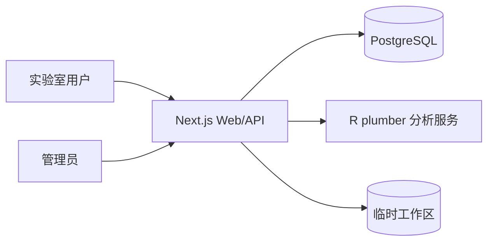

# 总体架构

## 1. 逻辑结构

Next.js 是唯一对外入口，负责登录、权限、业务数据、临时任务编排和下载。R 服务只处理分析请求，不直接访问 PostgreSQL。数据库保存业务管理数据，不保存测序任务的原始文件或历史结果。

## 2. 模块边界

| 模块 | V1 范围 | 数据保存 |
|---|---|---|
| 用户管理 | 管理员创建/停用账号、重置密码、角色 | PostgreSQL |
| Guide 库 | 当前用户独立的增删改查、校验、导出 | PostgreSQL |
| Sanger | 上传即显示文件表与命名规则实时预览、Guide 选择、排队分析、结果下载 | 临时工作区 |
| Nanopore | 交付包上传、样本选择、排队分析、结果下载 | 临时工作区 |
| 细胞冻存库 | xlsx/csv 导入、查询、单条录入、修改管数（自动留痕）、待核对修正 | PostgreSQL |
| 部门物料 | 采购记录查询（品牌/请购人筛选、排序）；管理员导入采购系统导出并整表替换 | PostgreSQL |
| 固定资产 | 研发部资产只读查询；管理员导入台账并整表替换 | PostgreSQL |
| 分析队列 | 全站先进先出、单任务运行，前端显示排队位置与预计时长 | 网页服务内存 |
| 审计日志 | 登录、导入、导出、删除、管理员操作 | PostgreSQL |

## 3. 临时数据生命周期

1. 用户上传文件，API 创建随机任务目录并限制大小、扩展名和数量。
2. Web/API 调用 R 服务，R 服务只读任务目录并返回结构化结果。
3. 用户下载 CSV/XLSX/ZIP 结果。
4. 任务完成后按 `TEMP_JOB_TTL_HOURS` 清理；失败任务也进入清理队列。
5. 数据库只记录任务状态和错误摘要，不记录原始序列、FASTQ 或可还原结果。

## 4. 权限

- `admin`：用户管理、部门物料导入、全局审计日志、系统配置。
- `member`：使用分析工具、维护自己的 Guide、查询和修改细胞库（不能删除）、查询部门物料。
- Guide 记录按 `owner_id` 隔离；细胞库和物料库对全体登录用户可读。
- 冰箱管理：冰箱清单由 admin 维护；容器和样品按 `owner_id` 隔离，admin 与开启「冰箱总览」的 member 可只读查看全部人员，不能修改他人数据。
- 所有导入、导出、删除、登录失败和管理员操作写入审计日志。

## 5. 安全与运行约束

- 密码使用 Argon2id 或 bcrypt 哈希；会话使用 HttpOnly、Secure、SameSite Cookie。
- 不把 `.env`、真实账号、样本编号、序列、原始 xlsx/CSV 提交到 Git。
- 生产环境通过 windows-wg 主机环境变量或仅管理员可读的配置文件注入密钥，不进 Git。
- API 对上传文件执行大小、扩展名、内容探测和路径隔离；禁止路径穿越。
- 部署在 windows-wg 原生安装（见 `decisions.md`）：PostgreSQL 数据目录与临时工作区放在 E: 盘，临时工作区设置清理任务；对外只开放 Web 端口，PostgreSQL 与 R 服务仅监听本机。
- windows-wg 同时运行标签打印服务（8080）和 MariaDB（3306），本系统不得占用这些端口或改动其配置。
